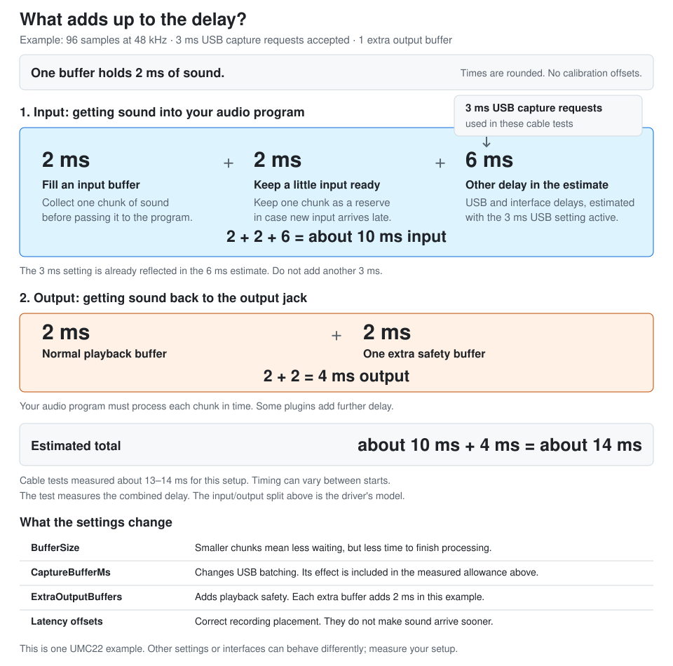

# ASIO-for-UMC22

A small 64-bit Windows ASIO driver for the Behringer UMC22 and other USB audio interfaces built on the same chip. It talks to the device through WDM Kernel Streaming, without the Windows audio mixer, and gives ASIO hosts such as DAWs stereo input and output at 44.1 or 48 kHz. Audio is exposed to the host as planar 32-bit floats and transferred to the device as interleaved 16-bit PCM.

Version 1.0.1 adds latency reporting measured on a UMC22 to the first public release, 1.0.0. It streams on a UMC22 under Windows 11 in a DAW; its latest engine changes were measured on a UMC22 in short benchmark runs (see [optimization notes](docs/OPTIMIZATION_NOTES.md)). The automated tests simulate Windows audio I/O. Long sessions and other interfaces are not yet systematically validated; see [hardware validation](docs/HARDWARE_VALIDATION.md).

## Features

- Low-latency streaming through Kernel Streaming, with buffers from 48 to 1008 samples (1 to 21 ms at 48 kHz).
- Optional shorter USB capture requests, with acceptance or rejection shown in the control panel. Together with input alignment, 3 ms requests lowered the input latency of a UMC22 by 4–6 ms.
- Input alignment: recorded input that consistently waits longer than needed is skipped, so input latency stays near the minimum the USB driver allows.
- Optional extra output buffers: each lets the DAW be one buffer late without a crackle, at the cost of one buffer of output latency.
- A control panel with the buffer size and output safety choices and session diagnostics. Many DAWs have no buffer-size setting for ASIO drivers and open this panel instead.
- Latency reported to the host includes the delay of Windows' USB audio driver, and can be calibrated with a loopback cable so that recordings line up exactly.
- Dropout handling: when output runs out of audio, the driver keeps input aligned with output instead of letting the input delay grow with every dropout.
- ASIO 2.3 overload reports, driver-internal buffering reports, and time information for the host.
- Clear error messages when the device is missing, in use by another program, or rejects the format.

## Compatible audio interfaces

The UMC22 is built around Texas Instruments' PCM2902 USB audio codec, and reports TI's default hardware ID `VID_08BB&PID_2902`. Many other interfaces and small mixers with USB audio use the same chip and ID, for example Behringer's UCA202 and UCA222. By default the driver opens the first device with that ID, so these devices work without configuration.

Devices with a related codec or another ID can be selected with the `DeviceName` setting (see [Configuration](#configuration)). A device works when:

- recording and playback belong to the same Windows audio device (playback-only USB DACs are not supported),
- both directions accept stereo 16-bit audio at 44.1 or 48 kHz, and
- it uses Windows' standard USB audio driver rather than a manufacturer driver.

Channel names follow the UMC22's labels: **In 1 (Mic/Line)**, **In 2 (Instrument)**, **Out 1 (L)**, and **Out 2 (R)**. `build/tools/latency_test.exe --info` shows within seconds whether the driver can open a connected device.

## Install

1. Close your DAW. Copy `asio_for_umc22.dll` and `asio_settings.ini` to a permanent folder.
2. In a 64-bit Administrator Command Prompt, register the DLL:

   ```cmd
   regsvr32 "C:\path\to\asio_for_umc22.dll"
   ```

3. In your DAW's audio settings, select the ASIO driver type and the device **ASIO-for-UMC22**.

Only one program can use the interface through this driver at a time. If Windows uses it as the default playback or recording device, select another default device in Windows' sound settings.

To uninstall, close the DAW and run:

```cmd
regsvr32 /u "C:\path\to\asio_for_umc22.dll"
```

## Configuration

`asio_settings.ini` lives beside the DLL. Invalid settings make initialization fail.

| Setting | Default | Meaning |
| --- | --- | --- |
| `SampleRate` | 48000 | 44100 or 48000. The DAW can change it while the driver is stopped. |
| `BufferSize` | 96 | Samples per buffer: multiples of 48 from 48 through 1008. The DAW may request another valid size. |
| `ExtraOutputBuffers` | 0 | 0, 1 or 2 extra output buffers. Each lets the DAW be one buffer late without a crackle, and adds one buffer of output latency. |
| `CaptureBufferMs` | 0 | USB capture request duration: 0 leaves Windows' default unchanged; 3 through 10 requests that many milliseconds. Restart the host after editing. See below. |
| `DeviceName` | empty | Part of a device's name or instance path. Empty selects the first `VID_08BB&PID_2902` device. |
| `InputLatencyOffset`, `OutputLatencyOffset` | 0 | Latency calibration in microseconds, may be negative (see [Latency](#latency)). |

| Buffer size | Duration at 48 kHz |
| --- | --- |
| 48 | 1 ms |
| 96 | 2 ms |
| 144 | 3 ms |
| 192 | 4 ms |

Smaller buffers lower latency but need more headroom from the system. 48 samples works on an idle system, but can crackle in a full DAW session; if you hear crackles or the control panel shows output dropouts, choose a larger size or add an extra output buffer. 48 samples with one extra output buffer has the output latency of 96 samples, but 1 ms less input latency.

### Changing settings from the DAW

Open the driver's control panel from your DAW's audio settings (often a button named **Hardware Setup**, **ASIO Settings**, or **Control Panel**) and pick a buffer size or output safety setting. The driver saves them as `BufferSize` and `ExtraOutputBuffers` and asks the DAW to reopen the driver with them. DAWs that ignore this request use the new settings the next time they open the driver.

### Requesting shorter USB capture buffering

Close the host, set `CaptureBufferMs=3` in `asio_settings.ini`, and reopen the host. Once audio buffers are open, the control panel shows whether Windows accepted the request. If the request is rejected, the driver continues with Windows' default. Set it back to `0` and reopen the host to restore the default behavior.

This uses Microsoft's [capture buffer duration property](https://learn.microsoft.com/en-us/windows-hardware/drivers/audio/ksproperty-audio-buffer-duration). Shorter requests can reduce capture latency, but increase USB processing frequency. On a UMC22, 3 ms requests together with input alignment lowered the recorded input waiting for the host from about 11 ms to 5 ms at 48 samples, and to 7 ms at 96 samples (see [optimization notes](docs/OPTIMIZATION_NOTES.md#input-alignment-and-extra-output-buffers)). Acceptance does not prove stable operation at 48 samples. The driver reports the input delay measured on a UMC22 for accepted 3 ms requests at buffers up to 2.5 ms and at exactly 3 ms (see [Latency](#latency)). At other buffer sizes the gain varied between starts, so the driver reports the default there and over-reports by up to about 3 ms; calibrate if you use them. Other durations (4–10 ms) are unmeasured and reported as the default, so check them with the loopback tool.

### Selecting a device

`DeviceName` is matched case-insensitively against the Device Manager name, the device instance path, and the interface path, and replaces the hardware-ID filter. A UMC22 usually appears as "USB Audio CODEC". If several devices share a name, use part of the instance path (Device Manager > Properties > Details > Device instance path). Names changed in Windows' sound settings are not used. The control panel shows which device was opened.

```ini
DeviceName=USB Audio CODEC
```

## Latency

Latency is the delay between a sound entering the interface and that sound reaching the output when you monitor through the DAW. It includes the input path, the DAW's processing, and the output path. Plugins can add further delay. The UMC22's direct hardware monitoring bypasses the DAW and follows a different path.

The driver reports an **input latency** and an **output latency** so the DAW can place recordings in time. These are estimates based on UMC22 measurements. A physical loopback test measures the actual round trip: audio goes from the DAW through an output, through a cable into an input, and back to the DAW. It measures the combined delay, not input and output separately.



For example, at **48 kHz with 96-sample buffers**, each buffer holds **2 ms** of audio. With 3 ms USB capture requests, the driver estimates the input delay as:

**2 ms to fill an input buffer + 2 ms kept ready as a reserve + about 6 ms from measurements = about 10 ms input.**

The final 6 ms is an allowance for other USB and interface delays, based on UMC22 cable tests. It accounts for the remaining delay in the model; it cannot be calculated from the buffer size alone. One normal output buffer and one extra safety buffer then add **2 + 2 = 4 ms**, giving **about 10 + 4 = 14 ms total**.

All times in this example and table are **rounded to whole milliseconds**. These driver estimates use zero calibration offsets and assume Windows accepts the 3 ms capture requests. They exclude any extra latency added by the DAW or plugins:

| USB capture setting | Extra output buffers | Input estimate | Output estimate | Reported total |
| --- | ---: | ---: | ---: | ---: |
| Windows default (`CaptureBufferMs=0`) | 0 | about 14 ms | 2 ms | about 16 ms |
| `CaptureBufferMs=3` | 0 | about 10 ms | 2 ms | about 12 ms |
| `CaptureBufferMs=3` | 1 | about 10 ms | 4 ms | about 14 ms |

The third row is the SVG's example. Its extra output buffer adds 2 ms of playback safety. Loopback tests on the measured UMC22 returned **about 13–14 ms** for that configuration: USB timing can differ between starts, so the reported estimate and a particular measurement need not match exactly. See the [precise measurements and latency model](docs/OPTIMIZATION_NOTES.md#built-in-latency-model) for other configurations.

`CaptureBufferMs=3` requests smaller USB capture batches; it does **not** set the whole input delay to 3 ms. Smaller ASIO buffers reduce waiting but leave the DAW less time to finish processing. Extra output buffers add waiting on playback to tolerate a late callback.

`InputLatencyOffset` and `OutputLatencyOffset` correct the numbers reported to the DAW, helping it place recordings accurately. They do **not** reduce the monitoring delay you hear. Check the loopback again after changing the device, sample rate, buffer size, capture setting or output safety; one calibration may not fit every configuration. Some variation between starts remains even after calibration.

### Input alignment

Windows can accumulate recorded audio while playback starts. That older audio can stay queued, making the DAW receive input later than necessary even with smaller USB capture requests.

Input alignment looks for recorded buffers that consistently waited longer than needed and discards the excess. It keeps a small reserve to tolerate late input, and increases that reserve if a dropout follows a trim. It only discards audio that has already arrived. With Windows' default capture blocks it generally finds nothing to trim; with 3 ms capture requests it removed 4–6 ms of queued input on the tested UMC22.

The control panel shows queued input, trimmed buffers and the reserve. **Queued input is one part of the input path, not the complete round-trip delay.** The [optimization notes](docs/OPTIMIZATION_NOTES.md#input-alignment-and-extra-output-buffers) describe the algorithm and its measurements.

### Measuring the round trip

Connect an output of the interface to an input with a cable, for example the headphone or RCA output to the instrument input, with the input gain low. Unplug headphones or turn speakers down: the test plays short 4 kHz pulses at -12 dBFS on both outputs. Close the DAW, then run:

```sh
make latency-test
build/tools/latency_test.exe
```

The tool uses the registered driver as a host would. It prints what the driver reports (channels, buffer sizes, rates, clock, latency, internal buffering, supported features), measures the round trip with 12 pulses, and recommends latency offsets. Extra delay is added to `OutputLatencyOffset`; reductions first adjust `InputLatencyOffset`, so shorter capture buffering can be calibrated without requiring a negative reported output latency. The loopback measures the total, not each direction separately. `--write` stores both offsets in the `asio_settings.ini` beside the registered DLL; `--info` only prints the report. If your DAW has its own latency or driver error compensation setting, set it to 0 after calibrating.

## Diagnostics

The control panel shows the opened device and its Windows driver, the output queue depth, the USB capture request and its result, the input alignment state, the reported latency and offsets, callback count, output dropouts and the output time they cost, input buffers skipped to stay in sync, callback budget overruns, longest callback, longest interval between callbacks, I/O errors, wait timeouts, short capture packets, page-lock failures, the last error, and the ASIO version and features of the host. They are grouped in sections, with problems highlighted, and **Copy details** copies the full report to the clipboard.

A dropout is counted when output has run out of queued audio before the next buffer is submitted. The device keeps recording meanwhile, so the driver measures how much later output plays and skips already-recorded input until the remaining excess is below one buffer plus 0.5 ms. Recovery skips up to four completed input packets per callback and stops starting more skips after 100 microseconds or one eighth of a buffer period, whichever is shorter. It also yields when output needs servicing or more input is not yet available; large stalls can take several callbacks to recover. If no owed input can be skipped for 80 ms (both directions stalled together), the driver stops expecting it. When the host supports it, the driver also sends an overload message. Short capture packets are padded with silence. Streaming errors request an ASIO reset when the host supports that message.

## How it works

- Capture and render pins are opened on the same KS audio filter. Discovery enumerates the pins, checks data flow and communication type, and lets `KsCreatePin` validate the requested PCM format. Both directions must open.
- The engine queues two output packets plus any extra output buffers, and two to nine capture packets, all while the pins are paused. It processes completed capture/playback pairs on an MMCSS "Pro Audio" thread; the host's double buffer index alternates whatever the queue depth. It uses completion events, does not change the system timer period, and does not allocate or log in the audio loop.
- Completed input is converted into the host's buffer and requeued before host DSP runs, so capture requests remain available while the host processes audio. Stop checks use an atomic flag; an event still wakes blocked waits.
- Pending requests are never reused before completion. Submission errors, completion errors, failed waits, and timeouts stop the stream and keep the Windows error. Shutdown joins the worker and drains cancelled requests before freeing memory, and waits rather than release memory still used by I/O.
- Sample-rate changes are rejected while buffers exist. Buffer sizes, channels, allocations, and startup state are validated, and partial allocation failures roll back.
- Sample positions and timestamps are published together; positions advance by output time lost in dropouts. Timestamps describe when the worker observed a completed buffer, not a hardware clock.
- SSE2 converts four input frames per iteration and packs eight stereo output frames per iteration, reducing packing work without requiring AVX2. Conversion clips overloads and turns NaNs into silence. All host buffers share one allocation, and pages are locked where possible.

## Build and tests

Build with MinGW-w64:

```sh
make -j2
```

This produces `asio_for_umc22.dll`, with the MinGW compiler runtimes linked in. `getDriverVersion()` returns `10001` for version 1.0.1. See [optimization notes](docs/OPTIMIZATION_NOTES.md) for the changes and their validation limits.

Run the portable conversion tests with a native C++ compiler, and the Windows tests with Wine:

```sh
make test-native
make test-windows
```

`make test-binaries` builds all test programs without running them. On Windows, use `make test-windows WINDOWS_RUNNER=` with a compatible shell and MinGW installation. The Windows tests use simulated KS requests and do not open audio hardware or register the DLL. They exercise real Windows events and worker threads, including held callbacks and delayed cancellation. A simulated device with a controlled clock checks dropout detection and input recovery at every supported buffer size and both sample rates, extra output buffers, and input alignment with input delivered in blocks of different sizes; it fails if the engine ever waits for input that has not been recorded. A separate test loads the actual DLL and checks its exports, version and COM lifecycle.

## License

Copyright (C) 2026 fraej

ASIO-for-UMC22 is free software: you can redistribute it and/or modify it under the terms of the GNU General Public License version 3, as published by the Free Software Foundation. It is distributed in the hope that it will be useful, but WITHOUT ANY WARRANTY; without even the implied warranty of MERCHANTABILITY or FITNESS FOR A PARTICULAR PURPOSE. See [LICENSE](LICENSE) for details.

ASIO is a trademark of Steinberg Media Technologies GmbH. This project defines the ASIO interface itself and does not include the ASIO SDK.
